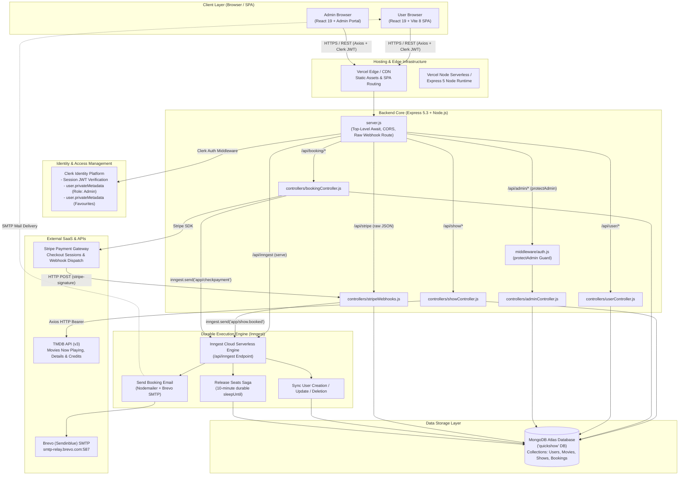
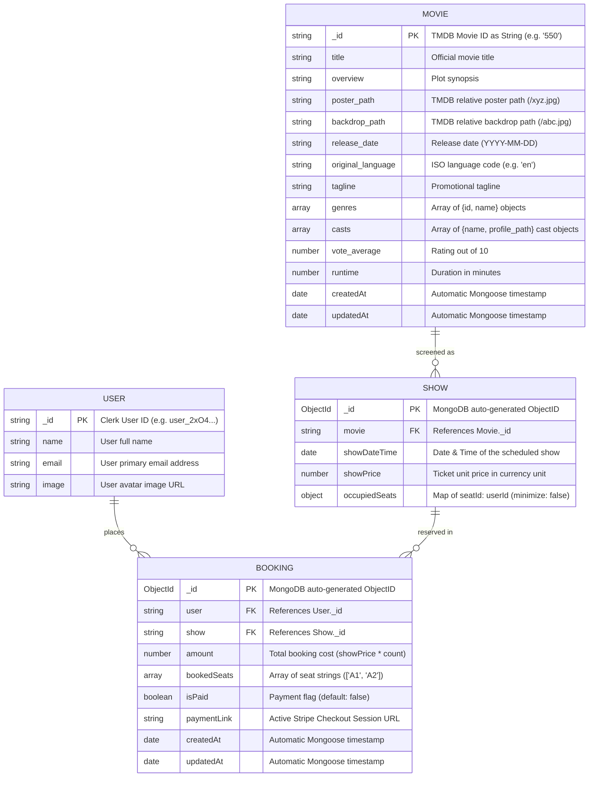
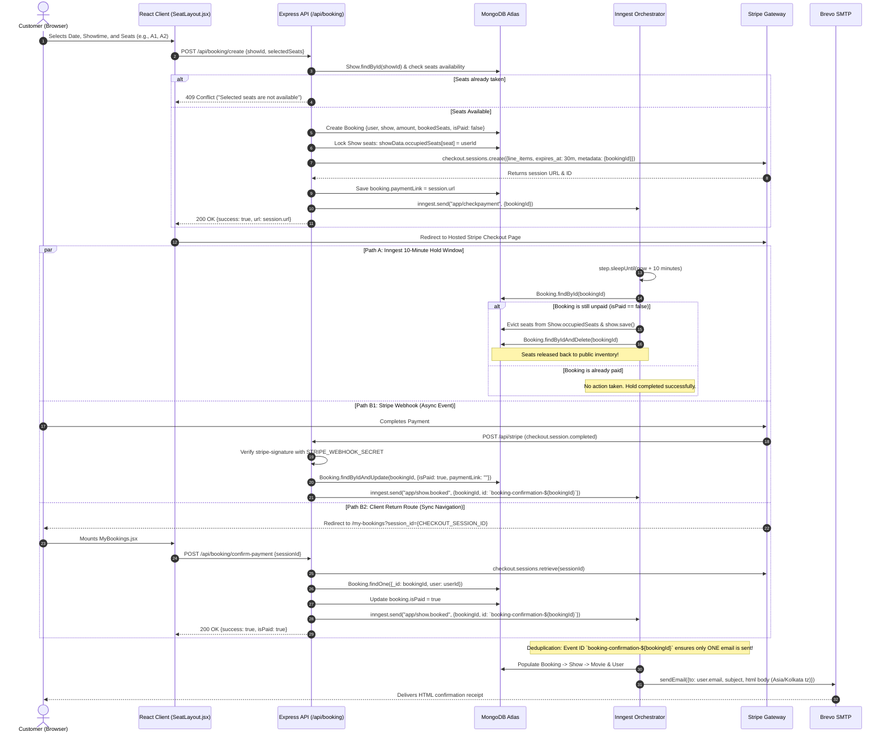
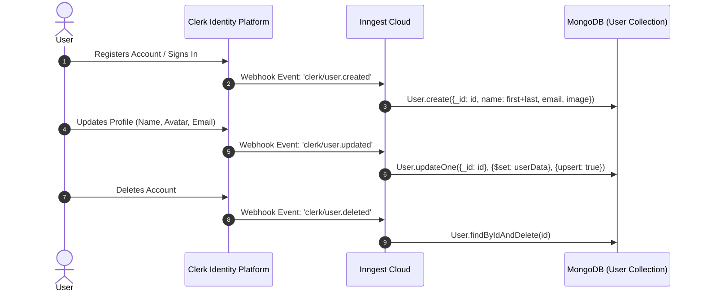
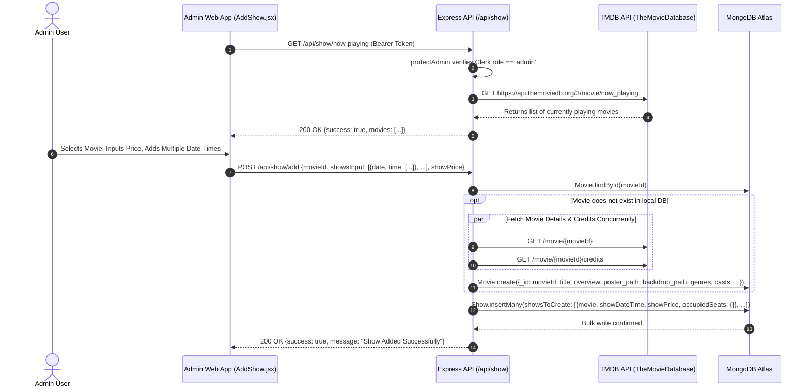
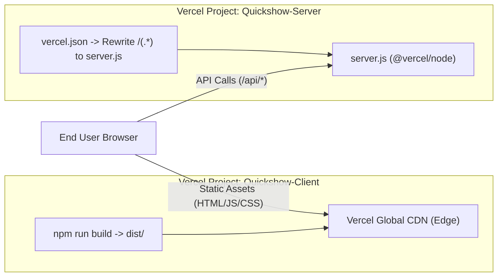

# QuickShow — Complete System Architecture & Codebase Map

> **Authoritative Architectural Blueprint & Technical Specification**  
> **Repository:** `quickshow`  
> **Generated:** March 2025  
> **Status:** Production Architecture Reference  

---

## Table of Contents
1. [Executive Summary & Architectural Paradigm](#1-executive-summary--architectural-paradigm)
2. [End-to-End System Architecture (Mermaid Visualizations)](#2-end-to-end-system-architecture-mermaid-visualizations)
   - [Macro System Topology](#macro-system-topology)
   - [Database Entity-Relationship Model (ERD)](#database-entity-relationship-model-erd)
   - [Seat Reservation & Checkout Distributed Saga](#seat-reservation--checkout-distributed-saga)
   - [User Lifecycle & Clerk-Inngest Synchronization](#user-lifecycle--clerk-inngest-synchronization)
   - [Show Creation & TMDB Ingestion Pipeline](#show-creation--tmdb-ingestion-pipeline)
   - [Client Component & State Tree](#client-component--state-tree)
3. [Complete Codebase Directory & File Map](#3-complete-codebase-directory--file-map)
4. [Technology Stack Matrix](#4-technology-stack-matrix)
5. [Backend Architecture Deep-Dive](#5-backend-architecture-deep-dive)
   - [Server Entry Point & Middleware Precedence](#server-entry-point--middleware-precedence)
   - [Database Connection & Top-Level Await](#database-connection--top-level-await)
   - [Data Models & Schema Specifications](#data-models--schema-specifications)
   - [REST API Specifications & Route Contracts](#rest-api-specifications--route-contracts)
6. [Asynchronous Orchestration & Distributed Sagas (Inngest Engine)](#6-asynchronous-orchestration--distributed-sagas-inngest-engine)
   - [Event Subscriptions & Workflow Specifications](#event-subscriptions--workflow-specifications)
   - [Idempotency & Race Condition Prevention](#idempotency--race-condition-prevention)
7. [Frontend Architecture & Client State Engine](#7-frontend-architecture--client-state-engine)
   - [React 19 & Vite 8 Application Framework](#react-19--vite-8-application-framework)
   - [AppContext & Axios Interceptors](#appcontext--axios-interceptors)
   - [Page Layouts & Component Taxonomy](#page-layouts--component-taxonomy)
   - [Seat Grid Rendering & Reservation Matrix](#seat-grid-rendering--reservation-matrix)
8. [Security, Authentication & Authorization Architecture](#8-security-authentication--authorization-architecture)
   - [Clerk JWT Pipeline](#clerk-jwt-pipeline)
   - [Role-Based Access Control (RBAC)](#role-based-access-control-rbac)
   - [Cryptographic Webhook Signature Verification](#cryptographic-webhook-signature-verification)
9. [Micro & Macro Nuances, Edge Cases & Implementation Quirks](#9-micro--macro-nuances-edge-cases--implementation-quirks)
10. [Environment Configurations & Deployment Runbook](#10-environment-configurations--deployment-runbook)

---

## 1. Executive Summary & Architectural Paradigm

**QuickShow** is a full-stack movie discovery, theater schedule browsing, and cinema seat reservation web platform. It enables cinema-goers to explore now-playing movies, watch trailers, inspect cast information, select showtimes, pick theater seats in a visual interactive 2D layout, and complete ticket purchases through a secure payment gateway. It also equips administrators with an administrative portal for ingesting movie metadata from external catalogs, scheduling screening slots, and monitoring platform revenue and bookings.

### Architectural Patterns Applied

```
+--------------------------------------------------------------------------------------------------+
|                                    QUICKSHOW ARCHITECTURE PATTERNS                               |
+-----------------------------------+----------------------------------+---------------------------+
| 1. Decoupled Monorepo             | 2. Distributed Saga / Hold Lock  | 3. Hybrid Metadata Store  |
| Client (Vite/React) & Server      | Inngest 10-minute delayed sleep  | Core data in MongoDB;     |
| (Express/Node) isolated in a      | saga releases unpaid seat locks  | User favorites & roles in |
| single repository root.           | automatically.                   | Clerk Private Metadata.   |
+-----------------------------------+----------------------------------+---------------------------+
| 4. Dual Payment Confirmation      | 5. Third-Party Ingestion Sync    | 6. Axios Interceptor      |
| Idempotent processing via both    | On-demand hydration of TMDB API  | Auto-attaches Clerk JWT & |
| Stripe Webhook and return URL     | data into MongoDB Movie schemas  | executes seamless 401     |
| handler with unique event keys.   | during admin show provisioning.  | token refresh & replay.   |
+-----------------------------------+----------------------------------+---------------------------+
```

1. **Decoupled Client-Server Monorepo**: Frontend and backend are maintained side-by-side in `client/` and `server/` with independent dependency manifests (`package.json`), build scripts, and execution environments.
2. **Event-Driven Asynchronous Saga (10-Minute Seat Reservation Hold)**: QuickShow addresses the classic concurrency challenge in ticket reservation (the "Seat Lock Problem") using **Inngest**. When a user selects seats and proceeds to checkout, the seats are instantly reserved in MongoDB and an `app/checkpayment` event triggers a durable Inngest background function that sleeps for 10 minutes. If the booking is not paid by that time, the held seats are evicted back into the general pool and the booking record is deleted.
3. **Idempotent Dual-Channel Payment Resolution**: Transactions are finalized either via real-time Stripe webhooks (`checkout.session.completed`, `payment_intent.succeeded`) or immediately when the browser returns to `/my-bookings?session_id=...`. Idempotency is guaranteed through deterministic Inngest event keys (`booking-confirmation-${bookingId}`).
4. **Third-Party Movie Ingestion & Caching**: Show scheduling leverages The Movie Database (TMDB) API. The admin selects a movie from TMDB's `now_playing` feed; QuickShow automatically fetches movie details and cast credits in parallel (`Promise.all`), hydrates local MongoDB `Movie` documents, and provisions multiple show instances.
5. **Hybrid Metadata Storage**: While movie documents, showtimes, and booking receipts reside in MongoDB, user authentication, role assignments (`role: "admin"`), and user favorite lists (`favourites: string[]`) reside in Clerk's `privateMetadata`, eliminating the overhead of synchronizing mutable profile arrays into relational user tables.

---

## 2. End-to-End System Architecture (Mermaid Visualizations)

### Macro System Topology

The following diagram illustrates the network boundaries, protocol flows, and external integrations of the platform:



---

### Database Entity-Relationship Model (ERD)

The MongoDB data schema consists of four core Mongoose collections. Notice the strategic use of external string identifiers for `User` (Clerk ID) and `Movie` (TMDB ID).



---

### Seat Reservation & Checkout Distributed Saga

The following sequence illustrates the reservation lock, 10-minute delayed expiration saga, and dual-channel confirmation pipeline:



---

### User Lifecycle & Clerk-Inngest Synchronization



---

### Show Creation & TMDB Ingestion Pipeline



---

### Client Component & State Tree

```mermaid
graph TD
    Root["main.jsx\nClerkProvider + BrowserRouter + AppProvider"]
    Root --> App["App.jsx\nRoutes & Layout Frame"]
    
    App --> NavBar["components/navBar.jsx\nLogo, Navigation Links, Search, UserButton / Login"]
    App --> Toaster["react-hot-toast (Toaster)"]
    App --> Footer["components/footer.jsx\nBranding, App Store Links, Contact"]
    
    App --> PublicRoutes["Public User Routes"]
    App --> AdminRoutes["Admin Guarded Routes (/admin/*)"]

    subgraph PublicViews ["Public Views"]
        Home["pages/home.jsx"]
        Home --> Hero["components/heroSection.jsx"]
        Home --> Featured["components/FeaturedSection.jsx"]
        Featured --> MovieCard1["components/MovieCard.jsx"]
        Home --> Trailers["components/TrailersSection.jsx\nReactPlayer + Carousel"]
        
        Movies["pages/movies.jsx\nAll Now-Showing Grid"]
        Movies --> MovieCard2["components/MovieCard.jsx"]
        
        MovieDetails["pages/movieDetails.jsx\nMovie Synopsis, Cast Carousel, DateSelect"]
        MovieDetails --> DateSelect["components/DateSelect.jsx\nDate Picker Tabs"]
        MovieDetails --> MovieCard3["components/MovieCard.jsx\nRecommendations"]
        
        SeatLayout["pages/SeatLayout.jsx\nTime Selector, 90-Seat Grid, Checkout Trigger"]
        
        MyBookings["pages/myBookings.jsx\nActive & Past Bookings, Pay Now Trigger, Sync Payment"]
        Favourite["pages/favourite.jsx\nFavorite Movies Grid from Clerk Metadata"]
    end

    subgraph AdminViews ["Admin Subsystem"]
        AdminLayout["pages/admin/Layout.jsx\nisAdmin Guard + Sidebar + Navbar Frame"]
        AdminLayout --> AdminNavbar["components/admin/AdminNavbar.jsx"]
        AdminLayout --> AdminSidebar["components/admin/AdminSidebar.jsx"]
        AdminLayout --> AdminDashboard["pages/admin/Dashboard.jsx\nKPI Cards, Revenue, Active Shows"]
        AdminLayout --> AddShow["pages/admin/AddShow.jsx\nTMDB Movie Picker, Multi-slot Time Matrix"]
        AdminLayout --> ListShows["pages/admin/ListShows.jsx\nTable of Active Shows & Earnings"]
        AdminLayout --> ListBookings["pages/admin/ListBookings.jsx\nTable of User Bookings & Status"]
    end

    PublicRoutes --> Home
    PublicRoutes --> Movies
    PublicRoutes --> MovieDetails
    PublicRoutes --> SeatLayout
    PublicRoutes --> MyBookings
    PublicRoutes --> Favourite

    AdminRoutes --> AdminLayout
```



---

## 3. Complete Codebase Directory & File Map

```
quickshow/
│
├── .gitignore                          # Global git exclusion rules (node_modules)
├── SYSTEM_ARCHITECTURE.md              # [This Document] Definitive System Architecture Specification
│
├── .postman/
│   └── resources.yaml                  # Postman workspace collaboration metadata (Workspace ID)
│
├── postman/
│   └── globals/
│       └── workspace.globals.yaml      # Postman workspace environment global variables definitions
│
├── server/                             # BACKEND APPLICATION ROOT (Node.js + Express 5)
│   ├── .env                            # Backend secrets & connection strings (MongoDB, Clerk, Stripe, Inngest, TMDB)
│   ├── package.json                    # Backend dependencies, type: "module", scripts (server, start)
│   ├── package-lock.json               # Backend locked dependency tree
│   ├── server.js                       # Primary server entrypoint, middleware chain, route mounting, Vercel export
│   ├── vercel.json                     # Backend Vercel serverless build and routing configuration
│   │
│   ├── configs/                        # Service Configurations & Clients
│   │   ├── db.js                       # Mongoose connection orchestrator with lifecycle listeners
│   │   ├── loadEnv.js                  # Explicit dotenv resolver referencing '../.env'
│   │   └── nodemailer.js               # Brevo SMTP transport creation & HTML email dispatch function
│   │
│   ├── controllers/                    # Business Logic Request Handlers
│   │   ├── adminController.js          # Admin dashboard metrics, shows query, all bookings query
│   │   ├── bookingController.js        # Seat check, booking creation, Stripe session creation, payment confirmation
│   │   ├── showController.js           # TMDB now-playing fetch, movie hydration, show addition, show queries
│   │   ├── stripeWebhooks.js           # Raw-body cryptographic signature check, payment_intent & checkout handlers
│   │   └── userController.js           # User bookings query, Clerk privateMetadata favourites get/update
│   │
│   ├── inngest/                        # Asynchronous Background Workflow Definitions
│   │   └── index.js                    # Inngest client, user sync jobs, 10-minute seat release saga, confirmation email
│   │
│   ├── middleware/                     # Express Request Processing Middleware
│   │   └── auth.js                     # protectAdmin guard querying Clerk privateMetadata.role === 'admin'
│   │
│   ├── model/                          # Mongoose Database Models & Schemas
│   │   ├── Booking.js                  # Booking schema (user, show, amount, bookedSeats, isPaid, paymentLink)
│   │   ├── Movie.js                    # Movie schema (TMDB fields, cast array, genre array, runtime, ratings)
│   │   ├── Show.js                     # Show schema (movie ref, showDateTime, showPrice, occupiedSeats object)
│   │   └── User.js                     # User schema (Clerk user ID, name, email, avatar image URL)
│   │
│   └── routes/                         # Express Route Declarations
│       ├── adminRoutes.js              # /api/admin endpoints (/is-admin, /dashboard, /all-shows, /all-bookings)
│       ├── bookingRoutes.js            # /api/booking endpoints (/create, /confirm-payment, /seats/:showId)
│       ├── showRoutes.js               # /api/show endpoints (/now-playing, /add, /all, /:movieId)
│       └── userRoutes.js               # /api/user endpoints (/bookings, /update-favourite, /favourites)
│
└── client/                             # FRONTEND APPLICATION ROOT (React 19 + Vite 8 SPA)
    ├── .env                            # Client environment variables (VITE_BASE_URL, Clerk keys, Currency, TMDB base)
    ├── .gitignore                      # Client git exclusions (dist, logs, editor settings)
    ├── eslint.config.js                # ESLint flat config with React Hooks & React Refresh rules
    ├── index.html                      # HTML5 entrypoint, viewport configuration, root container div
    ├── package.json                    # Frontend dependencies, scripts (dev, build, preview, lint)
    ├── package-lock.json               # Frontend locked dependency tree
    ├── README.md                       # Vite template documentation
    ├── vercel.json                     # Client Vercel configuration
    ├── vite.config.js                  # Vite configuration bundled with React and Tailwind v4 plugins
    │
    ├── public/                         # Public Static Assets
    │   ├── backgroundImage.png         # High-resolution hero background image
    │   ├── favicon.svg                 # Browser favicon
    │   └── icons.svg                   # General SVG icon pack
    │
    └── src/                            # Application Source Code
        ├── App.jsx                     # Root router configuration, conditional header/footer, route guards
        ├── index.css                   # Global styles, Tailwind v4 theme, Outfit Google Font, custom scrollbar
        ├── main.jsx                    # React 19 createRoot entry, ClerkProvider, BrowserRouter, AppProvider
        │
        ├── assets/                     # Component Assets & Fallback Mock Data
        │   ├── appStore.svg            # Apple App Store badge
        │   ├── assets.js               # Exported asset bundle, dummyTrailers, dummyShowsData, dummyBookingData
        │   ├── backgroundImage.png     # Local fallback hero background
        │   ├── chartIcon.svg           # Analytics chart icon
        │   ├── favicon.svg             # Application logo icon
        │   ├── googlePlay.svg          # Google Play badge
        │   ├── hero.png                # Hero section character artwork
        │   ├── logo.svg                # QuickShow brand vector logo
        │   ├── marvelLogo.svg          # Studio brand vector logo
        │   ├── profile.png             # Default user avatar placeholder
        │   ├── react.svg               # React vector logo
        │   ├── screenImage.svg         # Cinema curved theater screen graphic for seat picker
        │   └── vite.svg                # Vite vector logo
        │
        ├── components/                 # Reusable UI Presentation & Container Components
        │   ├── BlurCircle.jsx          # Ambient decorative glowing blurred circles
        │   ├── DateSelect.jsx          # Horizontal scrollable showtime date selector
        │   ├── FeaturedSection.jsx     # "Now Showing" carousel preview on homepage
        │   ├── footer.jsx              # Global footer with navigation, app badges, contact info
        │   ├── heroSection.jsx         # Full-bleed homepage hero banner with CTA
        │   ├── Loading.jsx             # Full-screen spinning loader with optional delayed navigation
        │   ├── MovieCard.jsx           # Movie thumbnail card with title, runtime, rating, and CTA
        │   ├── navBar.jsx              # Responsive navigation header, mobile slide-out drawer, Clerk login
        │   ├── TrailersSection.jsx     # Embedded ReactPlayer with interactive trailer video switcher
        │   └── admin/                  # Admin-Specific Subcomponents
        │       ├── AdminNavbar.jsx     # Header bar for the admin portal with branding
        │       └── AdminSidebar.jsx    # Sidebar navigation with active indicator and Admin profile badge
        │
        ├── context/                    # React Context State Engine
        │   └── AppContext.jsx          # Global AppProvider: shows, favourites, admin status, Axios with Clerk interceptor
        │
        ├── lib/                        # Formatting & Computation Utilities
        │   ├── dateFormat.js           # Formats dates to "Thu, October 24, 7:30 PM"
        │   ├── kConverter.js           # Formats numbers to "15.2k" notation
        │   └── timeFormat.js           # Formats minutes to "2h 15m" format
        │
        └── pages/                      # Page-Level Route Containers
            ├── favourite.jsx           # User's saved favorite movies grid
            ├── home.jsx                # Homepage combining Hero, Featured, and Trailers
            ├── movieDetails.jsx        # Detailed movie overview, cast gallery, recommendations, date picker
            ├── movies.jsx              # Full index grid of all currently running movies
            ├── myBookings.jsx          # User bookings history, ticket badges, payment retry, return-url processor
            ├── SeatLayout.jsx          # Interactive 90-seat theater grid, time selector, checkout launcher
            └── admin/                  # Admin Subsystem Pages
                ├── AddShow.jsx         # TMDB movie browser, price input, multi-date-time builder
                ├── Dashboard.jsx       # Overview KPI cards (Revenue, Bookings, Shows, Users) & active shows
                ├── Layout.jsx          # Admin layout wrapper enforcing admin authentication check
                ├── ListBookings.jsx    # Complete ledger table of all customer bookings
                ├── ListShows.jsx       # Ledger table of active shows, seat occupancy, and show earnings
                └── Title.jsx           # Reusable section title with highlighted underline accent
```

---

## 4. Technology Stack Matrix

| Domain | Technology / Library | Version | Operational Purpose & Architectural Rationale |
| :--- | :--- | :--- | :--- |
| **Frontend Framework** | **React** | `^19.2.8` | Component-based declarative UI architecture utilizing React 19 core features. |
| **Frontend Build Tool** | **Vite** | `^8.3.0` | Ultra-fast ESM-based development server and optimized Rollup production bundler. |
| **Styling Engine** | **Tailwind CSS** | `^4.3.3` | Next-generation CSS framework utilizing `@tailwindcss/vite` without legacy PostCSS overhead. |
| **Client Routing** | **React Router DOM** | `^7.18.4` | Declarative client-side routing, nested routes, route parameters, and location matching. |
| **Identity & Auth (Client)** | **@clerk/react** | `^6.17.8` | User authentication, session tokens, pre-built `UserButton`, `SignIn` modals. |
| **HTTP Client** | **Axios** | `^1.20.0` | Promise-based HTTP client customized with request & 401-refresh response interceptors. |
| **Media Player** | **React Player** | `^3.4.0` | Dynamic responsive YouTube video embed for movie trailer playback. |
| **Toast Notifications** | **React Hot Toast** | `^2.6.1` | Lightweight, non-intrusive toast notification system for feedback and errors. |
| **Iconography** | **Lucide React** | `^1.55.0` | Consistent, accessible tree-shakeable SVG icon collection. |
| **Backend Runtime** | **Node.js (ESM)** | `Node >= 18` | Standard JavaScript server runtime using native ES Modules (`"type": "module"`). |
| **Backend Framework** | **Express.js** | `^5.3.0` | Express 5 routing engine, upgraded promise handling, and middleware composition. |
| **Database ORM/ODM** | **Mongoose** | `^9.11.2` | Elegant schema modeling for MongoDB with validation, population, and hooks. |
| **Identity & Auth (Server)** | **@clerk/express** | `^2.1.78` | Express middleware extracting and validating Clerk JWTs into `req.auth()`. |
| **Background Orchestration** | **Inngest** | `^4.24.0` | Durable serverless execution engine for delayed sagas and event-driven workflows. |
| **Payment Gateway** | **Stripe Node SDK** | `^23.0.0` | Hosted checkout session creation, payment intents, and raw webhook verification. |
| **Transactional Email** | **Nodemailer** | `^10.1.6` | SMTP client configured with Brevo relay for dispatching HTML booking confirmations. |
| **Catalog API** | **TMDB API (v3)** | REST | External REST service providing authoritative movie data, casts, posters, and ratings. |

---

## 5. Backend Architecture Deep-Dive

### Server Entry Point & Middleware Precedence

The backend application bootstraps in `server/server.js`. The order of middleware declaration is architecturally critical:

```javascript
// CRITICAL ORDER OF EXECUTION IN server.js
import "./configs/loadEnv.js";          // 1. Guarantee environment variables are loaded
import express from "express";
import cors from "cors";
import connectDB from "./configs/db.js";
import { clerkMiddleware } from '@clerk/express';
import { serve } from "inngest/express";
import { inngest, functions } from "./inngest/index.js";
...

// 2. Immediate Configuration Validation
if (!clerkPublishableKey || !clerkSecretKey) {
    throw new Error("CLERK_PUBLISHABLE_KEY and CLERK_SECRET_KEY must be configured");
}

// 3. Top-Level Await Database Bootstrap
await connectDB();

// 4. STRIPE WEBHOOK ROUTE - MUST PRECED express.json()
app.use('/api/stripe', express.raw({ type: 'application/json' }), stripeWebhooks);

// 5. Standard Body Parsers & Security Middleware
app.use(express.json());
app.use(cors());
app.use(clerkMiddleware({ publishableKey, secretKey }));

// 6. Mount Subsystem Routes
app.use('/api/inngest', serve({ client: inngest, functions }));
app.use('/api/show', showRouter);
app.use('/api/booking', bookingRouter);
app.use('/api/admin', adminRouter);
app.use('/api/user', userRouter);

// 7. Conditional Server Listener (Vercel Serverless vs. Local Daemon)
if (process.env.VERCEL !== "1") {
    app.listen(port, () => console.log(`Server listening at http://localhost:${port}`));
}
export default app;
```

#### Why Stripe Webhooks Must Precede `express.json()`
Stripe's cryptographic verification (`stripeInstance.webhooks.constructEvent`) validates the cryptographic hash of the exact raw byte stream received in the HTTP request against the `stripe-signature` header. If `express.json()` processes the request first, it alters whitespace and deserializes the body into an object, causing Stripe signature verification to fail irreversibly with a `400 Bad Request`.

---

### Database Connection & Top-Level Await

In `server/configs/db.js`, Mongoose connects to MongoDB Atlas using top-level await in `server.js`:
```javascript
const connectDB = async () => {
    try {
        mongoose.connection.on('connected', () => console.log('Database connected'));
        await mongoose.connect(`${process.env.MONGODB_URI}/quickshow`);
    } catch (error) {
        console.log(error.message);
    }
}
```
Because Node.js ES Modules natively support top-level await, the server does not accept incoming HTTP traffic until the MongoDB connection handshake has successfully resolved.

---

### Data Models & Schema Specifications

#### 1. User Model (`server/model/User.js`)
- `_id`: String (Required). Contains the Clerk User ID (`user_xxxxxxxx`). Overrides MongoDB's default `ObjectId`.
- `name`: String (Required). Formatted full name (`${first_name} ${last_name}`).
- `email`: String (Required). Primary email address.
- `image`: String (Required). Profile avatar URL hosted by Clerk.

#### 2. Movie Model (`server/model/Movie.js`)
- `_id`: String (Required). TMDB Movie ID as string (e.g., `"550"`).
- `title`: String (Required).
- `overview`: String (Required).
- `poster_path`: String (Required). Relative path (e.g. `/path.jpg`).
- `backdrop_path`: String (Required). Relative path for full-bleed hero banners.
- `release_date`: String (Required). Format `YYYY-MM-DD`.
- `original_language`: String.
- `tagline`: String.
- `genres`: Array of objects (`[{id: 28, name: "Action"}]`).
- `casts`: Array of objects (`[{name: "Actor Name", profile_path: "/cast.jpg"}]`).
- `vote_average`: Number (Required). Float between 0.0 and 10.0.
- `runtime`: Number (Required). Total runtime in minutes.
- `timestamps`: `true` (`createdAt`, `updatedAt`).

#### 3. Show Model (`server/model/Show.js`)
- `movie`: String (Required, ref: `'Movie'`). Foreign key linking to `Movie._id`.
- `showDateTime`: Date (Required). ISO DateTime of the screening.
- `showPrice`: Number (Required). Price per ticket.
- `occupiedSeats`: Object (Default `{}`).
  > **Crucial Schema Setting**: `{ minimize: false }`.  
  > By default, Mongoose drops empty objects (`{}`) from document serialization. `{ minimize: false }` forces Mongoose to persist an empty dictionary when no seats are booked.
  > Additionally, mutations to keys within `occupiedSeats` require calling `show.markModified('occupiedSeats')` before `.save()` because Mongoose cannot detect deep property mutations on arbitrary untyped Objects.

#### 4. Booking Model (`server/model/Booking.js`)
- `user`: String (Required, ref: `'User'`). Foreign key linking to `User._id`.
- `show`: String (Required, ref: `'Show'`). Foreign key linking to `Show._id`.
- `amount`: Number (Required). Calculated as `showPrice * bookedSeats.length`.
- `bookedSeats`: Array of Strings (Required). e.g., `["A1", "A2"]`.
- `isPaid`: Boolean (Default: `false`). Set to `true` upon payment confirmation.
- `paymentLink`: String. Stores the active Stripe Checkout Session URL.
- `timestamps`: `true`.

---

### REST API Specifications & Route Contracts

| Method | Endpoint | Auth Guard | Controller Handler | Description & Payload Contract |
| :--- | :--- | :--- | :--- | :--- |
| **GET** | `/` | Public | Inline | Health check endpoint. Returns string `"Server is Live!"`. |
| **POST** | `/api/stripe` | Stripe Signature | `stripeWebhooks` | Consumes raw JSON body. Verifies signature against `STRIPE_WEBHOOK_SECRET`. Handles `checkout.session.completed`, `checkout.session.async_payment_succeeded`, and `payment_intent.succeeded`. |
| **ALL** | `/api/inngest` | Inngest Secret | `serve(...)` | Serves Inngest functions and event ingestion pipeline. |
| **GET** | `/api/show/now-playing` | `protectAdmin` | `getNowPlayingMovies` | Queries TMDB `/movie/now_playing` with Bearer API Key. Returns `{success: true, movies}`. |
| **POST** | `/api/show/add` | `protectAdmin` | `addShow` | Ingests new shows. Body: `{movieId: string, showsInput: [{date, time: []}], showPrice: number}`. Fetches TMDB details if movie is new, then executes `Show.insertMany(...)`. |
| **GET** | `/api/show/all` | Public | `getShows` | Retrieves upcoming shows (`showDateTime >= now`). Populates `movie`. De-duplicates using `Set` on `show.movie` and returns distinct movie array. |
| **GET** | `/api/show/:movieId` | Public | `getShow` | Fetches movie document and aggregates all upcoming shows grouped by ISO date: `{success: true, movie, dateTime: {"2025-06-30": [{time, showId}]}}`. |
| **POST** | `/api/booking/create` | User JWT | `createBooking` | Body: `{showId, selectedSeats}`. Checks seat availability, locks seats in `Show.occupiedSeats`, creates `Booking`, generates Stripe Checkout Session, sends `app/checkpayment` event to Inngest, returns `{success: true, url}`. |
| **POST** | `/api/booking/confirm-payment` | User JWT | `confirmBookingPayment`| Body: `{sessionId}`. Queries Stripe for session status. If `paid`, updates booking `isPaid = true` and triggers Inngest `app/show.booked` event with deterministic ID. |
| **GET** | `/api/booking/seats/:showId` | Public | `getOccupiedSeats` | Returns array of occupied seat IDs: `{success: true, occupiedSeats: ["A1", "A2"]}`. |
| **GET** | `/api/user/bookings` | User JWT | `getUserBookings` | Returns all bookings for `req.auth().userId`, populated with `show` and `movie`, sorted by `createdAt: -1`. |
| **POST** | `/api/user/update-favourite` | User JWT | `updateFavourite` | Body: `{movieId}`. Toggles `movieId` within Clerk's `user.privateMetadata.favourites` via `clerkClient.users.updateUserMetadata(...)`. |
| **GET** | `/api/user/favourites` | User JWT | `getFavourites` | Reads `favourites` array from Clerk `user.privateMetadata`, queries MongoDB `Movie.find({_id: {$in: favourites}})`, and returns array of full movie objects. |
| **GET** | `/api/admin/is-admin` | `protectAdmin` | `isAdmin` | Returns `{success: true, isAdmin: true}` if user has admin role in Clerk metadata. |
| **GET** | `/api/admin/dashboard` | `protectAdmin` | `getDashboardData` | Aggregates paid bookings, calculates `totalRevenue`, queries upcoming shows, and counts users. Returns `{totalBookings, totalRevenue, activeShows, totalUser}`. |
| **GET** | `/api/admin/all-shows` | `protectAdmin` | `getAllShows` | Returns all shows scheduled in the future sorted by `showDateTime: 1`. |
| **GET** | `/api/admin/all-bookings` | `protectAdmin` | `getAllBookings` | Returns all historical bookings in the platform populated with `user`, `show`, and `movie`. |

---

## 6. Asynchronous Orchestration & Distributed Sagas (Inngest Engine)

The file `server/inngest/index.js` encapsulates the durable background workflow execution logic using Inngest SDK v4.

```
+-----------------------------------------------------------------------------------------------+
|                                  INNGEST FUNCTION REGISTRY                                    |
+------------------------------------+--------------------------+-------------------------------+
| Function ID                        | Trigger Event            | Purpose                       |
+------------------------------------+--------------------------+-------------------------------+
| sync-user-from-clerk               | clerk/user.created       | Creates User in MongoDB       |
| update-user-from-clerk             | clerk/user.updated       | Upserts User in MongoDB       |
| delete-user-with-clerk             | clerk/user.deleted       | Deletes User in MongoDB       |
| release-seats-delete-booking       | app/checkpayment         | 10-minute hold release saga   |
| send-booking-confirmation-email    | app/show.booked          | Brevo SMTP HTML confirmation  |
+------------------------------------+--------------------------+-------------------------------+
```

### 1. The 10-Minute Seat Reservation Release Saga
When a customer clicks "Proceed to Checkout", the seats are reserved in the database immediately to prevent other users from buying them simultaneously. However, if the user abandons the checkout tab, the seats must not remain locked indefinitely:

```javascript
const releaseSeatsAndDeleteBooking = inngest.createFunction(
    { id: 'release-seats-delete-booking', triggers: { event: 'app/checkpayment' } },
    async ({ event, step }) => {
        const tenMinutesLater = new Date(Date.now() + 10 * 60 * 1000);
        
        // 1. Durable Sleep: Engine suspends execution state for 10 minutes
        await step.sleepUntil('wait-for-10-minutes', tenMinutesLater);

        // 2. Evaluates payment state after the sleep interval
        await step.run('check-payment-status', async () => {
            const bookingId = event.data.bookingId;
            const booking = await Booking.findById(bookingId);

            if (booking && !booking.isPaid) {
                const show = await Show.findById(booking.show);
                if (show) {
                    booking.bookedSeats.forEach((seat) => {
                        delete show.occupiedSeats[seat]; // Release lock
                    });
                    show.markModified('occupiedSeats');
                    await show.save();
                }
                // Evict abandoned booking record
                await Booking.findByIdAndDelete(booking._id);
            }
        });
    }
);
```

### 2. Idempotency & Race Condition Prevention
Payments can be confirmed through two distinct channels:
1. **Asynchronous Stripe Webhook**: Stripe server-to-server POST to `/api/stripe`.
2. **Synchronous Client Navigation**: Browser returning to `/my-bookings?session_id=...` which triggers `POST /api/booking/confirm-payment`.

To prevent the user from receiving two confirmation emails if both channels resolve simultaneously, both handlers dispatch the Inngest event with an **explicit, deterministic event ID**:
```javascript
await inngest.send({
    id: `booking-confirmation-${bookingId}`,  // Deterministic Idempotency Key!
    name: "app/show.booked",
    data: { bookingId }
});
```
Inngest automatically de-duplicates any events sharing the same `id` within its deduplication window, guaranteeing that the email function executes exactly once.

---

## 7. Frontend Architecture & Client State Engine

### React 19 & Vite 8 Application Framework
The client application is built on React 19 and bundled via Vite 8. The entrypoint `client/src/main.jsx` nests the provider hierarchy:
```jsx
<ClerkProvider publishableKey={PUBLISHABLE_KEY}>
    <BrowserRouter>
        <AppProvider>
            <App />
        </AppProvider>
    </BrowserRouter>
</ClerkProvider>
```

### AppContext & Axios Interceptors
`client/src/context/AppContext.jsx` is the operational nerve center of the client. It provisions a specialized Axios instance with automated authentication lifecycle management:

```
+--------------------------------------------------------------------------------------------------+
|                                    AXIOS INTERCEPTOR PIPELINE                                    |
+--------------------------------------------------------------------------------------------------+
| Outgoing Request:                                                                                |
| 1. Checks if request contains Authorization header.                                              |
| 2. Awaits fresh JWT from Clerk: `const token = await getToken()`.                                |
| 3. Injects: `config.headers.Authorization = 'Bearer ' + token`.                                  |
+--------------------------------------------------------------------------------------------------+
| Incoming Response (Error Handling):                                                              |
| 1. Intercepts HTTP 401 Unauthorized errors.                                                      |
| 2. Checks if `!config._clerkRetry`.                                                              |
| 3. Forces fresh token retrieval skipping cache: `await getToken({skipCache: true})`.             |
| 4. Sets `config._clerkRetry = true` and replays the original request automatically!              |
+--------------------------------------------------------------------------------------------------+
```

### Page Layouts & Component Taxonomy

#### 1. Public Pages
- **`Home.jsx`**: Composes `HeroSection` (Marvel Guardians promo), `FeaturedSection` (4-card preview with "Now Showing" and "Show more" button), and `TrailersSection` (`ReactPlayer` video player with 4 interactive thumbnail buttons).
- **`Movies.jsx`**: Full-catalog responsive grid displaying all currently running movies fetched from `/api/show/all`.
- **`MovieDetails.jsx`**: In-depth view displaying movie poster, backdrop, genre pills, user rating, runtime, overview, horizontal scrollable cast gallery, favorite toggle button, and the `DateSelect` component.
- **`SeatLayout.jsx`**: Visual interactive theater seating plan.
- **`MyBookings.jsx`**: Displays user tickets, seat codes, total price, formatted dates, "Pay Now" links for unpaid orders, and handles automatic session confirmation via URL parameters.
- **`Favourite.jsx`**: Grid of user-favorited movies hydrated from Clerk metadata.

#### 2. Admin Subsystem (`client/src/pages/admin/`)
- **`Layout.jsx`**: Guarded boundary. Checks `isAdmin` state from `AppContext`. If unauthorized or unauthenticated, redirects to `/` or displays a Clerk `<SignIn fallbackRedirectUrl="/admin"/>` card.
- **`Dashboard.jsx`**: Displays 4 metric KPI cards (Total Bookings, Total Revenue, Active Shows, Total Users) and a gallery of active shows with current prices and times.
- **`AddShow.jsx`**: Admin show creator. Fetches TMDB now-playing movies, displays a selectable horizontal list with check indicators, input for ticket price, an interactive `datetime-local` picker that groups shows by date, and dispatches bulk show additions to `/api/show/add`.
- **`ListShows.jsx`**: Tabular list of active shows detailing movie title, showtime, total occupied seats, and computed earnings (`occupiedSeats.length * showPrice`).
- **`ListBookings.jsx`**: Complete table of all user bookings across the platform.

---

### Seat Grid Rendering & Reservation Matrix

`SeatLayout.jsx` renders a 90-seat cinema auditorium organized into 5 row-pair blocks:
```javascript
const groupRows = [["A","B"], ["C","D"], ["E","F"], ["G","H"], ["I","J"]];
// Each row contains 9 seats (e.g. A1 through A9, J1 through J9)
// Total auditorium capacity = 10 rows * 9 seats = 90 seats.
```

```
+-----------------------------------------------------------------------------+
|                                SCREEN SIDE                                  |
|                 (Curved Display Graphic - screenImage.svg)                  |
+-----------------------------------------------------------------------------+
|                                                                             |
|      [A1] [A2] [A3] [A4] [A5] [A6] [A7] [A8] [A9]      <-- Row A (Normal)   |
|      [B1] [B2] [B3] [B4] [B5] [B6] [B7] [B8] [B9]      <-- Row B            |
|                                                                             |
|   [C1] [C2] [C3] ... [C9]     |     [D1] [D2] [D3] ... [D9]   (Aisle Split) |
|   [E1] [E2] [E3] ... [E9]     |     [F1] [F2] [F3] ... [F9]                 |
|   [G1] [G2] [G3] ... [G9]     |     [H1] [H2] [H3] ... [H9]                 |
|   [I1] [I2] [I3] ... [I9]     |     [J1] [J2] [J3] ... [J9]                 |
+-----------------------------------------------------------------------------+
```

#### Seat Selection State Rules:
1. **Timing Prerequisite**: Clicking a seat before choosing a showtime triggers `toast("Please select time first")`.
2. **Occupied State**: Seats whose IDs exist in `occupiedSeats` array are styled with `opacity-50` and disabled. Clicking them triggers `toast("This seat is already booked")`.
3. **Seat Ceiling Constraint**: Users cannot select more than 5 seats per single booking transaction (`selectedSeats.length > 4`). Violations trigger `toast("You can only select 5 seats")`.
4. **Active Selection**: Selected seats toggle between active state (`bg-primary text-white`) and default outline state.

---

## 8. Security, Authentication & Authorization Architecture

### Clerk JWT Pipeline
1. **Client Token Issuance**: When a user signs in, Clerk manages session cookies and provides a `getToken()` method through the `@clerk/react` hook `useAuth()`.
2. **Bearer Token Transmission**: The Axios interceptor automatically retrieves the latest JWT and attaches it to the `Authorization: Bearer <token>` header for all authenticated requests.
3. **Server Validation**: On the server, `clerkMiddleware({ publishableKey, secretKey })` parses the bearer token, validates its cryptographic signature against Clerk's public keys, and attaches the authentication context to `req.auth()`.

### Role-Based Access Control (RBAC)
QuickShow protects administrative routes through a specialized middleware guard in `server/middleware/auth.js`:

```javascript
export const protectAdmin = async (req, res, next) => {
    try {
        const { userId } = req.auth();
        if (!userId) {
            return res.status(401).json({ success: false, message: "Authentication required" });
        }

        // Fetch user record directly from Clerk's Management API
        const user = await clerkClient.users.getUser(userId);

        // Strict role validation in privateMetadata
        if (user.privateMetadata?.role !== 'admin') {
            return res.status(403).json({
                success: false,
                message: 'Admin access requires privateMetadata.role to be set to "admin" in Clerk'
            });
        }

        next();
    } catch (error) {
        return res.status(500).json({ success: false, message: "Unable to verify admin access" });
    }
}
```

> **Security Advantage of `privateMetadata`**:  
> In Clerk, `publicMetadata` is readable by the frontend client, and `unsafeMetadata` can be modified by the frontend user. `privateMetadata` can **only** be viewed and modified by backend servers using the `CLERK_SECRET_KEY`, preventing users from tampering with their role or escalating privileges.

### Cryptographic Webhook Signature Verification
To prevent replay attacks and spoofed payment notifications, `server/controllers/stripeWebhooks.js` verifies incoming webhook payloads using the official Stripe signing secret:
```javascript
const sig = request.headers["stripe-signature"];
event = stripeInstance.webhooks.constructEvent(
    request.body, // Must be unparsed raw Buffer
    sig,
    process.env.STRIPE_WEBHOOK_SECRET
);
```

---

## 9. Micro & Macro Nuances, Edge Cases & Implementation Quirks

| Nuance Category | Location | Nuance Description & Architectural Impact |
| :--- | :--- | :--- |
| **Micro / Typo** | `client/src/pages/SeatLayout.jsx:142-143` | `<BlurCircle too="-100px" left="-100px"/>` contains prop name `too` instead of `top`. The component falls back to default `top="auto"`. |
| **Micro / Typo** | `client/src/pages/admin/Dashboard.jsx:94` | The fallback loading state renders `<loading/>` in lowercase instead of `<Loading/>`. In JSX, lowercase is treated as an unknown HTML element. |
| **Micro / Logic** | `client/src/pages/admin/ListBookings.jsx:56` | Maps seats using `Object.keys(item.bookedSeats).map(seat => item.bookedSeats[seat]).join(", ")` instead of direct array join `item.bookedSeats.join(", ")`. It functions because array index keys map back to values, but is a nuance from early schema iterations. |
| **Micro / Config** | `client/vercel.json` | Contains `"dest": "server.js"` and `"src": "/(./*)"`. This was evidently duplicated from `server/vercel.json` instead of a standard Vite SPA redirect rule (`{"source": "/(.*)", "destination": "/index.html"}`). |
| **Macro / State** | `client/src/App.jsx:27-28` | `isUnknownMovie` evaluates `!dummyShowsData.some(...)` against static mock data rather than the dynamic `shows` state from MongoDB to determine whether to hide the footer. |
| **Macro / Timezone** | `server/inngest/index.js:113-114` | The booking confirmation email hardcodes timezone `Asia/Kolkata` (`{ timeZone: "Asia/Kolkata" }`) regardless of the user's geographic location or server locale. |
| **Macro / Concurrency**| `server/model/Show.js:9` | Uses `occupiedSeats: { type: Object, default: {} }` with `{ minimize: false }`. Mongoose drops empty objects by default without this flag. Furthermore, `show.markModified('occupiedSeats')` is mandatory when mutating properties on this object. |
| **Macro / Metadata** | `server/controllers/userController.js:46` | Favorites are stored in Clerk's `user.privateMetadata.favourites` instead of a MongoDB collection, coupling user preference persistence to Clerk's API rate limits and availability. |
| **Macro / Ingestion** | `server/controllers/showController.js:29-32` | Uses `Promise.all` to fetch TMDB movie details and cast credits in parallel before inserting into MongoDB, optimizing latency during admin show creation. |
| **Macro / Saga** | `server/inngest/index.js:69-70` | Inngest uses durable sleep (`step.sleepUntil`) for 10 minutes. If the backend process crashes or restarts during this period, Inngest resumes execution in the cloud seamlessly without losing the timer. |

---

## 10. Environment Configurations & Deployment Runbook

### Environment Variables Matrix

#### Backend (`server/.env`)
```ini
# Database Connection
MONGODB_URI=mongodb+srv://<user>:<password>@cluster.mongodb.net

# Clerk Authentication (Server)
CLERK_PUBLISHABLE_KEY=pk_test_...
CLERK_SECRET_KEY=sk_test_...

# Inngest Background Orchestration
INNGEST_EVENT_KEY=...
INNGEST_SIGNING_KEY=...

# TMDB Movie Database API
TMDB_API_KEY=...

# Stripe Payment Gateway
STRIPE_PUBLISHABLE_KEY=pk_test_...
STRIPE_SECRET_KEY=sk_test_...
STRIPE_WEBHOOK_SECRET=whsec_...

# Transactional Email (Brevo SMTP - Referenced in nodemailer.js)
SMTP_USER=...
SMTP_PASS=...
SENDER_EMAIL=...
```

#### Frontend (`client/.env`)
```ini
# Application Currency Symbol (e.g. $, ₹, €)
VITE_CURRENCY=$

# Clerk Authentication (Client)
VITE_CLERK_PUBLISHABLE_KEY=pk_test_...

# Backend API Root URL
VITE_BASE_URL=http://localhost:3000

# TMDB CDN Image Base URL
VITE_TMDB_IMAGE_BASE_URL=https://image.tmdb.org/t/p/original
```

---

### Local Development Setup Runbook

#### 1. Clone & Install Dependencies
Open two terminal instances for concurrent client and server execution:

```bash
# Terminal 1: Backend Setup
cd server
npm install
npm run server    # Starts nodemon watching server.js on port 3000

# Terminal 2: Frontend Setup
cd client
npm install
npm run dev       # Starts Vite dev server on http://localhost:5173
```

#### 2. Inngest Local Dev Server
To test delayed sagas and background functions locally:
```bash
npx inngest-cli@latest dev -u http://localhost:3000/api/inngest
```

#### 3. Stripe Webhook Tunneling
To forward real Stripe events to your local machine:
```bash
stripe listen --forward-to localhost:3000/api/stripe
# Copy the printed webhook signing secret into server/.env as STRIPE_WEBHOOK_SECRET
```

#### 4. Granting Admin Access
To grant a user access to the admin portal (`/admin`):
1. Navigate to the **Clerk Dashboard** -> **Users**.
2. Select the target user.
3. Edit **Private Metadata** and input:
```json
{
  "role": "admin"
}
```
4. Save metadata. The user can now access `/admin`, view the dashboard, and schedule shows.

---

### Production Deployment Topology (Vercel)



When deploying to Vercel:
1. **Server project**: Deployed as Node.js serverless functions using `server/vercel.json`. Set environment variable `VERCEL=1` so `app.listen()` is omitted and the Express app is exported directly.
2. **Client project**: Configured with Root Directory `client`, Framework Preset `Vite`, and build output `dist`. Ensure SPA rewrite is enabled so client-side routes (`/movies/:id`, `/my-bookings`) resolve to `index.html`.
